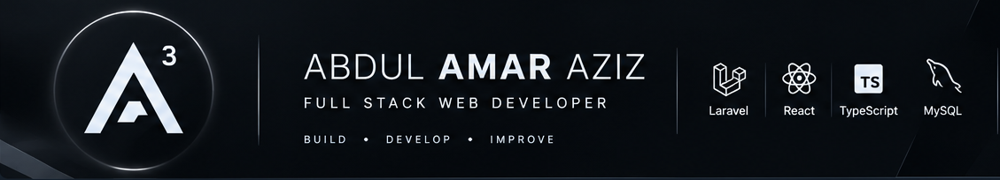

# Abdul Amar Aziz

### Full Stack Web Developer | Backend & Application Development

Building practical web applications, APIs, and digital solutions.

  
  
  
  

<i>Build · Develop · Improve</i>

---

## 👨‍💻 About Me

Hi! I'm **Abdul Amar Aziz**, a Diploma graduate in Informatics Engineering from **Universitas Dian Nuswantoro (UDINUS)**, Indonesia.

I'm interested in software development, especially full-stack web development, backend systems, and database-driven applications.

I enjoy turning requirements into practical applications with clear functionality, maintainable code, and useful user experiences. I'm also interested in digitalizing business processes and building integrated information systems.

- 🎓 Informatics Engineering graduate — UDINUS
- 💻 Focused on web application and backend development
- 📱 Familiar with Android application development using Java
- 🗄️ Interested in databases, APIs, and integrated information systems
- 🌱 Continuously learning and improving my software development skills

---

## 🛠️ Tech Stack

### Programming Languages

  
  
  
  

### Frameworks & Development

  
  
  

### Tools & Databases

  
  
  

---

## 🚀 Featured Projects

### 01. Arfath Store — Mobile E-Commerce

An Android e-commerce application for an electronics store, featuring product browsing, cart functionality, and shipping-cost integration.

**Technologies:** Java · Android Studio · API Integration

[View Repository →](https://github.com/AzizPro-maker/mobile-ecommerce)

### 02. Campurejo Village Information System

A web application for managing village cash income, expenses, and community activities.

**Technologies:** PHP · Database Management

[View Repository →](https://github.com/AzizPro-maker/desa_campurejo)

### 03. Hotel CRUD Backend

A web development project focused on CRUD operations and structured data management using CodeIgniter 4.

**Technologies:** CodeIgniter 4 · JavaScript

[View Repository →](https://github.com/AzizPro-maker/crudInputHotel)

### 04. Personal Portfolio

A personal portfolio project showcasing my development work, technical interests, and projects.

**Technologies:** TypeScript · Web Development

[View Repository →](https://github.com/AzizPro-maker/portfolio-aziz)

---

## 🎓 Education

**Universitas Dian Nuswantoro (UDINUS)**

Diploma (D3) in Informatics Engineering

2023 – 2026

---

## 📜 Professional Certifications

| Year | Certification | Issuer |
|:---:|:---|:---|
| 2026 | GenAI for SEO: A Hands-On Playbook | IBM |
| 2025 | Mobile Apps Development | LSP UDINUS |
| 2024 | Junior Web Development | LSP UDINUS |

---

## 💡 Development Interests

- Full-stack web application development
- Backend development and API integration
- Database design and management
- Business process digitalization
- Integrated information systems
- Mobile application development

---

## 🤝 Let's Connect

  <a href="https://github.com/AzizPro-maker">GitHub</a> ·
  <a href="https://www.linkedin.com/in/amar-aziz-13a76a380/">LinkedIn</a> ·
  <a href="https://instagram.com/aziz_amar56">Instagram</a> ·
  <a href="https://www.facebook.com/share/1C8jgdzd9A/">Facebook</a>

I'm always interested in learning new technologies, building useful applications, and collaborating on software development projects.

---

### A³ — Abdul Amar Aziz

<i>Learning, building, and analyzing one project at a time.</i>

